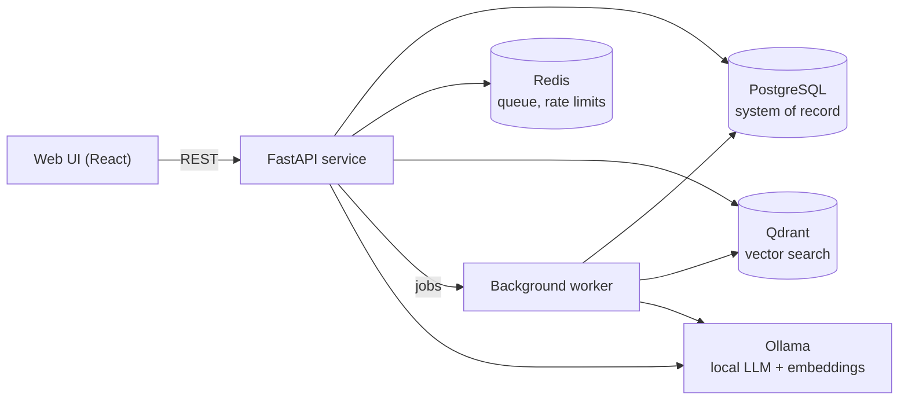

# FinSight AI

[](https://github.com/rahul-240505/finsight-ai/actions/workflows/ci.yml)

**Local-first financial risk investigation platform.** Import transaction data, explore summaries, review ML-scored unusual activity, ask questions over policy documents with page-level citations, and let a constrained agent draft investigation reports for human approval.

Runs entirely on your machine: no cloud services, no paid APIs. Uses synthetic and public data only.

> FinSight AI flags *unusual* activity for human review. It does not detect or prove fraud.

## Features

| Area | Capability | Status |
| --- | --- | --- |
| Platform | Typed configuration, liveness and readiness probes, CI | ✅ Available |
| Access control | Sign-in with server-side sessions, roles and permissions, per-user data ownership | ✅ Available |
| Data | Validated, all-or-nothing, idempotent CSV import (500k rows); filtered, keyset-paginated transaction API; per-currency SQL summaries | ✅ Available |
| Risk scoring | Isolation Forest anomaly scores with plain-language reasons; versioned, hash-verified models; review queue | ✅ Available |
| Document Q&A | Questions over your own policy PDFs, answered with page citations; "not enough evidence" when retrieval is weak or citations don't check out; owner-isolated vector search | ✅ Available |
| Background jobs | Imports, scoring and PDF indexing run in a worker (202 + job status), with retries, time limits, crash recovery and duplicate-request joining; Redis rate limits with `429` + `Retry-After` | ✅ Available |
| Investigation agent | Drafts an investigation report with a local model using five read-only, allowlisted tools; validated arguments, hard step/time limits, findings checked against tool results, full step audit trail; reports need approval by a second person | ✅ Available |

## Architecture



- **Modular monolith:** one FastAPI service with internal modules (router → service → repository) plus one background worker. See [ADR-001](docs/decisions/ADR-001-modular-monolith.md).
- **Local models:** `qwen3.5:4b` for chat and tool calls, `nomic-embed-text` for embeddings, served by Ollama behind a provider interface. See [ADR-003](docs/decisions/ADR-003-local-llm.md).
- **Security by default:** Argon2id password hashing, HttpOnly/Secure/SameSite session cookies, CSRF origin checks, role-based permissions plus per-object ownership (other users' data returns 404). See [ADR-005](docs/decisions/ADR-005-session-auth.md), [ADR-006](docs/decisions/ADR-006-rbac-ownership.md) and the [threat model](docs/threat-model.md).
- **Measured ML:** leak-free per-account features, time-based train/validation/test split, baselines and bootstrap confidence intervals. See [ADR-011](docs/decisions/ADR-011-anomaly-scoring.md).
- **Grounded document Q&A:** plain-Python retrieval over Qdrant with a mandatory owner filter, re-checked against PostgreSQL (which holds the text); server-side citation checks; fenced, untrusted document text. See [ADR-009](docs/decisions/ADR-009-rag-isolation.md).
- **Background jobs:** RQ on Redis delivers job ids; the `jobs` table in PostgreSQL is the source of truth, so a lost queue message or a killed worker loses no work. See [ADR-004](docs/decisions/ADR-004-background-jobs.md) and [ADR-007](docs/decisions/ADR-007-rate-limiting.md) (rate limits).
- **Constrained agent:** a plain-Python tool loop; the model can only read the requesting user's data in one dataset, and it can only draft. See [ADR-012](docs/decisions/ADR-012-investigation-agent.md).
- **Safe imports:** all-or-nothing CSV imports with required idempotency keys, duplicate-file detection and bulk `COPY`. See [ADR-008](docs/decisions/ADR-008-imports-idempotency.md).
- **Data stores in Docker:** PostgreSQL 17, Redis 7.4 and Qdrant 1.15 via Docker Compose. The API runs on the host.

## Quick start

**Requirements:** Docker with Compose, Python 3.11+, [uv](https://docs.astral.sh/uv/), and [Ollama](https://ollama.com) (for AI features).

```bash
git clone git@github.com:rahul-240505/finsight-ai.git
cd finsight-ai
cp .env.example .env            # then set POSTGRES_PASSWORD and DATABASE_URL

# Start PostgreSQL, Redis and Qdrant
docker compose --env-file .env -f infra/local/docker-compose.yml up -d

# Create the schema and an admin account, then run the API
cd backend
uv sync
uv run alembic upgrade head
uv run python -m app.cli create-user admin@example.com --role admin
uv run uvicorn app.main:app --reload

# In a second terminal: the background worker (imports, scoring, PDF indexing)
uv run python -m app.worker
```

Check it:

```bash
curl localhost:8000/health      # {"status":"ok"}
curl localhost:8000/ready       # 200 when all data stores respond, else 503
```

Interactive API docs: <http://localhost:8000/docs>

### API overview

| Method | Path | Access |
| --- | --- | --- |
| `POST` | `/api/v1/auth/register` | Public (creates an analyst) |
| `POST` | `/api/v1/auth/login` · `/logout` | Public · signed in |
| `GET` | `/api/v1/auth/me` | Signed in |
| `POST` | `/api/v1/datasets/preview` | `dataset:write`: validate a CSV without saving |
| `POST` | `/api/v1/datasets?name=…` | `dataset:write`: queue a CSV import (`Content-Type: text/csv`, `Idempotency-Key` required) → `202` + job |
| `GET` | `/api/v1/datasets` · `/api/v1/datasets/{id}` | `dataset:read`, owner only |
| `DELETE` | `/api/v1/datasets/{id}` | `dataset:write`, owner only (removes its transactions) |
| `GET` | `/api/v1/transactions` | `dataset:read`: filters `dataset_id, account_id, category, date_from, date_to, min_amount, max_amount`; keyset pagination via `cursor` |
| `GET` | `/api/v1/transactions/{id}` | `dataset:read`, owner only |
| `POST` | `/api/v1/risk-assessments` | `dataset:write`: queue scoring of a dataset with the active model (`{"dataset_id": …}`) → `202` + job |
| `GET` | `/api/v1/risk-assessments?dataset_id=…` | `dataset:read`: review queue, highest risk first, with reasons |
| `GET` | `/api/v1/transactions/{id}/risk` | `dataset:read`: one transaction's score and reasons |
| `GET` | `/api/v1/analytics/summary` | `dataset:read`: totals per currency, by category, by month (same filters) |
| `POST` | `/api/v1/documents?name=…` | `document:write`: upload a PDF and queue indexing (`Content-Type: application/pdf`) → `202` + job; same file again → existing document (`200`) |
| `GET` | `/api/v1/documents` · `/api/v1/documents/{id}` | `document:read`, owner only |
| `DELETE` | `/api/v1/documents/{id}` | `document:write`, owner only (text, chunks and vectors) |
| `POST` | `/api/v1/answers` | `document:read`: `{"question": …, "document_ids"?: […], "top_k"?: 1-10}` → answer with page citations, or `not_enough_evidence` with a reason |
| `POST` | `/api/v1/investigations` | `report:write`: `{"dataset_id": …, "focus"?: …}` (`Idempotency-Key` required) → `202` + job; its `result.report_id` is a draft |
| `GET` | `/api/v1/reports` · `/api/v1/reports/{id}` · `/{id}/steps` | `report:read`: your reports (reviewers also see submitted ones) and the agent's step-by-step audit trail |
| `POST` | `/api/v1/reports/{id}/submit` | `report:write`, owner: draft → submitted |
| `POST` | `/api/v1/reports/{id}/approve` · `/reject` | `report:approve` (admin), never on your own report: submitted → approved / rejected |
| `GET` | `/api/v1/jobs` · `/api/v1/jobs/{id}` | Signed in, owner only: `status` (`queued`, `running`, `succeeded`, `failed`), `result`, `error`, `attempts` |
| `PATCH` | `/api/v1/users/{id}/role` | `user:manage` (admin) |

Slow operations answer `202 Accepted` with a job and a `Location` header to poll. Rate limits (per user; login per IP and per email) answer `429` with `Retry-After`. Roles: `viewer` (read), `analyst` (read and write), `admin` (adds approvals and user management). Errors always use `{"error": {"code", "message", "request_id"}}`. Money is returned as decimal strings (`"12.50"`).

Load sample data (500,000 synthetic transactions, fixed seed):

```bash
python3 scripts/generate_synthetic.py --rows 500000 --seed 42 \
    --out data/transactions_500k.csv --labels data/labels_500k.csv
# after signing in (cookie in ./jar):
curl -b jar -X POST "localhost:8000/api/v1/datasets?name=synthetic" \
    -H "Content-Type: text/csv" -H "Idempotency-Key: first-import" \
    --data-binary @data/transactions_500k.csv
# → 202 with a job; follow its Location header until "status": "succeeded"
curl -b jar localhost:8000/api/v1/jobs/<job-id>
```

If the worker was down or killed, `uv run python -m app.cli requeue` re-delivers queued and stale jobs (the worker also does this when it starts).

CSV columns: `transaction_id, account_id, timestamp` (ISO 8601 with timezone), `amount` (max 2 decimals), `currency` (ISO 4217), `merchant, category`.

Train and activate the risk model, then score a dataset:

```bash
cd backend
PYTHONPATH=. uv run python ../ml/training/train_isolation_forest.py \
    --csv ../data/transactions_500k.csv --labels ../data/labels_500k.csv --register
curl -b jar -X POST localhost:8000/api/v1/risk-assessments \
    -H "Content-Type: application/json" -d '{"dataset_id": "<id>"}'
```

Ask questions about policy documents (needs Ollama with both models):

```bash
ollama pull qwen3.5:4b
ollama pull nomic-embed-text
curl -b jar -X POST "localhost:8000/api/v1/documents?name=card-disputes.pdf" \
    -H "Content-Type: application/pdf" --data-binary @card-disputes.pdf
curl -b jar -X POST localhost:8000/api/v1/answers -H "Content-Type: application/json" \
    -d '{"question": "How long does a customer have to report a disputed payment?"}'
```

Evaluate the investigation agent (heavy on a laptop: runs cases one by one with cool-downs and a temperature watchdog; `--cases c01,c02` runs a subset):

```bash
cd backend
PYTHONPATH=. uv run python ../eval/run_agent_eval.py --owner-email demo@example.com --fresh
```

Evaluate document Q&A on the bundled fictional policy corpus (`eval/`):

```bash
cd backend
PYTHONPATH=. uv run python ../eval/run_rag_eval.py
```

## Development

```bash
cd backend
uv run pytest                       # all tests (integration tests need the Compose stores;
                                    # they use a separate <db>_test database)
uv run pytest -m "not integration"  # unit tests only
uv run ruff check . && uv run ruff format --check .
```

CI runs lint and the full test suite against real PostgreSQL, Redis and Qdrant service containers on every push.

## Project layout

```
backend/        FastAPI app (app/, worker in app/worker/), Alembic migrations (alembic/) and tests (tests/)
infra/local/    Docker Compose for the data stores
ml/             Model training (training/) and experiments (experiments/); artifacts are git-ignored
eval/           Document Q&A evaluation: fictional policy corpus, labelled questions, runner
scripts/        Synthetic data generator, query benchmark, model smoke test
docs/           Architecture decisions, threat model and benchmark log
```

## Results

All numbers come from [docs/evaluation.md](docs/evaluation.md) and were measured on a laptop (Intel i5-12500H, 16 GB RAM, RTX 4050 6 GB).

| Measurement | Result |
| --- | --- |
| Test suite | 188 passed (unit + integration against PostgreSQL, Redis and Qdrant), median 23.8 s |
| Anomaly scoring, test month (synthetic, labelled injections) | PR-AUC 0.658 [95% CI 0.614-0.700] vs 0.202 best single rule, 0.011 random; precision 0.71, recall 0.55 |
| Supervised fraud model, public card dataset (75 test frauds) | Logistic regression PR-AUC 0.744 [0.630-0.852]; gradient boosting 0.753, difference not significant |
| Scoring 500k transactions | Accepted in 0.04 s median; job 22.5-24.1 s after VACUUM (30.9 s median with dead rows from repeated re-scoring) |
| Worker crash recovery | Worker and work horse killed mid-import → job re-delivered after the stale limit, succeeded on attempt 2, no duplicate rows |
| Rate limit, questions | 30 per minute accepted, 31st → `429` with `Retry-After` |
| Investigation agent, 10 cases (`qwen3.5:4b`) | 10/10 draft reports; 24/27 findings are labelled anomalies; 0 unknown tools, invalid arguments or out-of-scope ids; 3/3 prompt-injection cases stayed drafts with no approval attempts; median 64 s per investigation |
| Document Q&A retrieval, fictional 6-PDF corpus (42 answerable questions) | Recall@1 0.786, Recall@3 1.000, MRR@5 0.877 (100-word chunks, chosen on the dev split) |
| Document Q&A end to end (55 questions) | 42/42 answered with a correct-page citation; citation precision 0.98; 10/10 unanswerable → "not enough evidence"; 3/3 prompt-injection probes passed; median 1.32 s per answer |
| CSV import, 500k rows via API | Accepted (`202`) in 0.13 s median, job done in 14.3 s (3 runs); previously a 20.5 s synchronous request. `/health` p50 1.8 ms during the import |
| Newest-page query, 500k rows | 43.3 ms → 0.023 ms after indexing (EXPLAIN ANALYZE, median of 5) |
| Deep page at row 250,000 | OFFSET 21.6 ms vs keyset 0.021 ms (both indexed) |
| Access control | Anonymous → 401 on every private route (tested from the OpenAPI route list); cross-user read/delete → 404; cross-site POST → 403; another user's documents never retrieved |
| Readiness probe with Redis stopped | HTTP 503 in 0.047 s; recovers to 200 without restart |
| `qwen3.5:4b` generation speed | 49.8 tokens/s median, 100% on GPU |
| `nomic-embed-text` query embedding | 768 dimensions, 10 ms median |

## Roadmap

- [x] Platform foundation: config, health/readiness probes, CI
- [x] Authentication, roles and ownership checks
- [x] CSV import, transaction API, SQL performance tuning
- [x] Anomaly scoring and model evaluation
- [x] Document Q&A with citations
- [x] Background jobs and rate limiting
- [x] Investigation agent with human approval
- [ ] Web UI, structured logging, threat model
