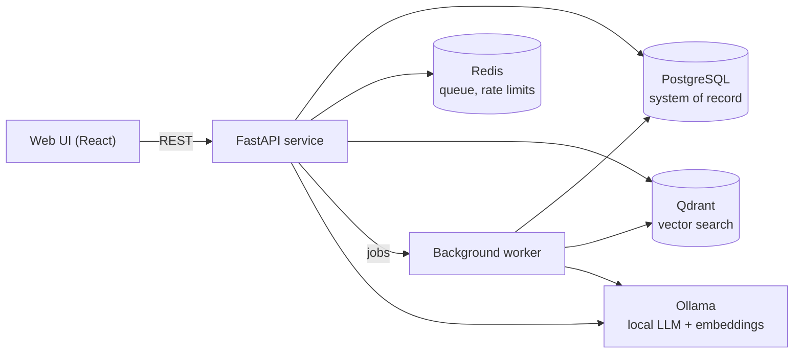

# FinSight AI

[](https://github.com/rahul-240505/finsight-ai/actions/workflows/ci.yml)

**Local-first financial risk investigation platform.** Import transaction data, explore summaries, review ML-scored unusual activity, ask questions over policy documents with page-level citations, and let a constrained agent draft investigation reports for human approval.

Runs entirely on your machine: no cloud services, no paid APIs. Uses synthetic and public data only.

> FinSight AI flags *unusual* activity for human review. It does not detect or prove fraud.

## Features

| Area | Capability | Status |
| --- | --- | --- |
| Platform | Typed configuration, liveness and readiness probes, CI | ✅ Available |
| Access control | Sign-in, roles, per-user data ownership | 🛠️ Planned |
| Data | Validated, idempotent CSV import; filtered and paginated transaction API; SQL summaries | 🛠️ Planned |
| Risk scoring | Isolation Forest anomaly scores with reasons; versioned models | 🛠️ Planned |
| Document Q&A | RAG over policy PDFs with page citations and an "insufficient evidence" fallback | 🛠️ Planned |
| Background jobs | Worker queue for slow tasks; rate limiting | 🛠️ Planned |
| Investigation agent | Read-only allowlisted tools, step limits, audit log, human approval | 🛠️ Planned |

## Architecture



- **Modular monolith:** one FastAPI service with internal modules (router → service → repository) plus one background worker. See [ADR-001](docs/decisions/ADR-001-modular-monolith.md).
- **Local models:** `qwen3.5:4b` for chat and tool calls, `nomic-embed-text` for embeddings, served by Ollama behind a provider interface. See [ADR-003](docs/decisions/ADR-003-local-llm.md).
- **Data stores in Docker:** PostgreSQL 17, Redis 7.4 and Qdrant 1.15 via Docker Compose. The API runs on the host.

## Quick start

**Requirements:** Docker with Compose, Python 3.11+, [uv](https://docs.astral.sh/uv/), and [Ollama](https://ollama.com) (for AI features).

```bash
git clone git@github.com:rahul-240505/finsight-ai.git
cd finsight-ai
cp .env.example .env            # then set POSTGRES_PASSWORD and DATABASE_URL

# Start PostgreSQL, Redis and Qdrant
docker compose --env-file .env -f infra/local/docker-compose.yml up -d

# Run the API
cd backend
uv sync
uv run uvicorn app.main:app --reload
```

Check it:

```bash
curl localhost:8000/health      # {"status":"ok"}
curl localhost:8000/ready       # 200 when all data stores respond, else 503
```

Interactive API docs: <http://localhost:8000/docs>

Optional, for AI features:

```bash
ollama pull qwen3.5:4b
ollama pull nomic-embed-text
```

## Development

```bash
cd backend
uv run pytest                       # all tests (integration tests need the Compose stores)
uv run pytest -m "not integration"  # unit tests only
uv run ruff check . && uv run ruff format --check .
```

CI runs lint and the full test suite against real PostgreSQL, Redis and Qdrant service containers on every push.

## Project layout

```
backend/        FastAPI app (app/) and tests (tests/)
infra/local/    Docker Compose for the data stores
scripts/        Utility scripts (model smoke test)
docs/           Architecture decisions and benchmark log
```

## Results

All numbers come from [docs/evaluation.md](docs/evaluation.md) and were measured on a laptop (Intel i5-12500H, 16 GB RAM, RTX 4050 6 GB).

| Measurement | Result |
| --- | --- |
| Test suite | 8 passed (unit + integration) |
| Readiness probe with Redis stopped | HTTP 503 in 0.047 s; recovers to 200 without restart |
| `qwen3.5:4b` generation speed | 49.8 tokens/s median, 100% on GPU |
| `nomic-embed-text` query embedding | 768 dimensions, 10 ms median |

## Roadmap

- [x] Platform foundation: config, health/readiness probes, CI
- [ ] Authentication, roles and ownership checks
- [ ] CSV import, transaction API, SQL performance tuning
- [ ] Anomaly scoring and model evaluation
- [ ] Document Q&A with citations
- [ ] Background jobs and rate limiting
- [ ] Investigation agent with human approval
- [ ] Web UI, structured logging, threat model
