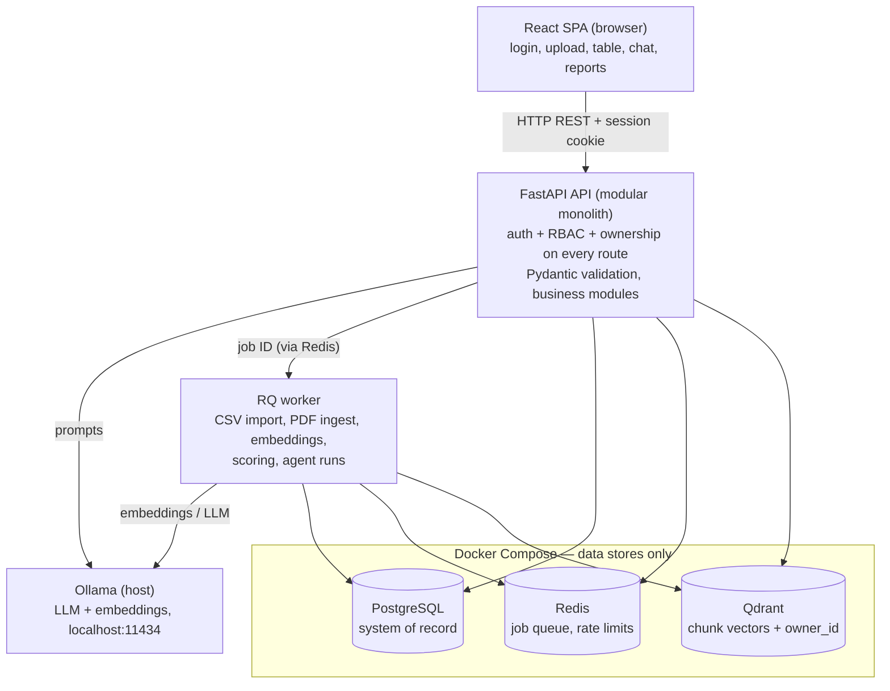

# FinSight AI — Study Guide

> The repo copy of the study hub. Claude Code updates this file at the end of every phase (see CLAUDE.md §8).
> It mirrors the claude.ai "FinSight AI — Study Hub" doc (the doc has longer model answers in Part C): Part A = tab "A · Phases", Part B = tab "B · Core Concepts", Part C = tab "C · Interview Q&A". Claude Code can't edit the doc, so at each phase end it prints a paste-ready "Study Hub update" per tab.

## Update log

| Date | Phase | What changed |
| --- | --- | --- |
| 2026-11-24 | — | Initial planned-design version. Nothing built yet. |

## Phase status

| Phase | Focus | Status | Measured result to cite (from docs/evaluation.md) |
| --- | --- | --- | --- |
| 0 | Foundation: repo, Compose, /health, CI | Not started | — |
| 1 | Core backend: DB, auth, RBAC, IDOR tests | Not started | — |
| 2 | Data and SQL: CSV import, APIs, indexing | Not started | — |
| 3 | ML: Isolation Forest + supervised model | Not started | — |
| 4 | RAG: PDFs, chunking, Qdrant, citations | Not started | — |
| 5 | Async jobs: RQ, Redis, rate limiting | Not started | — |
| 6 | Agent: allowlisted tools, human approval | Not started | — |
| 7 | Finish: frontend, logging, threat model, docs | Not started | — |

Status values: `Not started` · `In progress` · `Done (tests pass)`. Only numbers we actually ran go in the last column.

---

# PART A — Phases

## Architecture and request flows

FinSight AI is a **modular monolith** (one FastAPI app split into modules) plus **one background worker**. Data stores run in Docker; the API, worker, frontend and Ollama run directly on the host.

The API is the only door: it checks who you are and what you own before touching any store.

**Flow 1 — normal request (list transactions)**
1. Browser sends request with session cookie.
2. API dependency loads the user and checks the role permission.
3. Pydantic validates query parameters.
4. Service runs SQL filtered by `owner_id` → returns a page of results.

**Flow 2 — long job (import CSV, ingest PDF)**
1. API validates upload + Idempotency-Key, writes a `jobs` row, commits.
2. API enqueues the job ID in Redis, returns **202 + job_id**.
3. Worker runs the job, updates status/progress in Postgres.
4. Browser polls `GET /jobs/{id}` until `succeeded` or `failed`.

**Flow 3 — RAG question**
1. API embeds the question via Ollama.
2. Qdrant search **with owner_id filter** returns top-k chunks.
3. Weak evidence → "not enough evidence". Otherwise LLM answers from the chunks with [doc, page] citations.
4. API checks each citation matches a retrieved chunk, then responds.

**Flow 4 — investigation agent**
1. API creates an investigation job (202).
2. Worker runs the agent loop: model proposes tool → server validates → tool runs with the user's permissions.
3. Limits stop the loop; every step is logged.
4. Result is a **draft** report; a human with `report:approve` approves it.

> Each phase below has the same shape: Goal · What gets built · How it works · Key decisions · Done when · Pitfalls · Evidence to record · **How the code works (file by file)** · **Results**. The last two are filled in by Claude Code when the phase is built.

## Phase 0 — Foundation

**Goal:** a clean, testable skeleton every later phase plugs into. No business logic yet.

**What gets built**
- `infra/local/docker-compose.yml` — PostgreSQL, Redis, Qdrant only; named volumes, health checks.
- `backend/pyproject.toml` — FastAPI, Uvicorn, Pydantic Settings, pytest, httpx, ruff.
- `backend/app/main.py` — app factory, `GET /health` (liveness), `GET /ready` (checks DB, Redis, Qdrant).
- `backend/app/core/config.py` — typed settings from env vars; `.env.example` committed, `.env` ignored.
- `backend/tests/test_health.py` — first pytest with FastAPI TestClient.
- `.github/workflows/ci.yml` — on push: install, `ruff check`, `ruff format --check`, `pytest`.

**How it works**
1. `docker compose up -d` starts the three data stores on localhost.
2. `uvicorn app.main:app --reload` runs the API on the host.
3. Settings load once at startup from env vars; missing required values fail fast.
4. CI repeats lint + tests on a clean machine.

**Key decisions:** data stores in containers, app on host (fast reload, easy debugging); liveness vs readiness kept separate.
**Done when:** `/health` 200, `/ready` reports each dependency, CI green.
**Pitfalls:** committing `.env`; hard-coded ports; readiness check without timeout.
**Evidence to record:** CI passing; test count.

**How the code works (file by file):** _to be written when built._
**Results:** _none yet._

## Phase 1 — Core backend: database, auth, permissions

**Goal:** users can sign in, and can only touch their own data.

**What gets built**
- `app/db/` — SQLAlchemy 2.0 models, session factory, Alembic migrations.
- `users` table (email UNIQUE, password_hash, role, disabled_at).
- `app/core/security.py` — Argon2id hashing (argon2-cffi), session/token creation and checks.
- `app/api/v1/auth.py` — register, login, logout, me.
- `app/core/permissions.py` — roles (admin, analyst, viewer) → permissions (`dataset:read`, `dataset:import`, `report:approve`, …).
- Dependencies `get_current_user`, `require_permission("...")` on every protected route.
- Tests: login success/fail, wrong role → 403, user A reading user B's object → 404 (IDOR).

**How it works**
1. Register: password → Argon2id hash with random salt → stored. Plain password never stored or logged.
2. Login: verify hash → session credential in HttpOnly, Secure, SameSite cookie (or short-lived JWT — ADR-005).
3. Each request: dependency reads credential → loads user → checks permission → query **filtered by owner_id**.
4. Not your object → 404 (not 403), so attackers can't learn which IDs exist.

**Key decisions:** cookie session vs JWT; RBAC + ownership instead of ABAC; 404 for foreign objects.
**Done when:** auth + IDOR tests pass; migrations upgrade and downgrade cleanly.
**Pitfalls:** role checks without ownership checks; login reveals whether an email exists; CSRF with cookies; tokens in localStorage.
**Evidence to record:** number of auth/permission tests; IDOR test list.

**How the code works (file by file):** _to be written when built._
**Results:** _none yet._

## Phase 2 — Data and SQL

**Goal:** import transaction CSVs safely and query them fast at scale.

**What gets built**
- Tables: `datasets` (owner_id, content_hash, status, row_count), `transactions` (dataset_id, external_ref, amount NUMERIC, currency, occurred_at, merchant, category), `idempotency_records`.
- `modules/transactions/validation.py` — Pydantic row model: required columns, types, dates, currency codes, ranges, duplicates → preview + error list before commit.
- `POST /api/v1/datasets` — accepts `Idempotency-Key`; imports in one DB transaction.
- `GET /api/v1/transactions` — filters (date, amount, category), sorting, keyset or offset pagination.
- `GET /api/v1/analytics/summary` — totals, averages, counts by category/month via `GROUP BY`.
- `scripts/generate_synthetic.py` — 500k+ realistic rows, fixed random seed.
- `docs/evaluation.md` entry — `EXPLAIN ANALYZE` before/after indexes.

**How it works**
1. Upload → size/row limits → parse → validate each row → preview.
2. Confirm → one transaction inserts dataset row + valid rows (bulk insert / COPY).
3. `UNIQUE(dataset_id, external_ref)` + idempotency table stop duplicates on retry.
4. Same key + same body → saved result; same key + different body → 409/422.
5. Composite indexes such as `(dataset_id, occurred_at)`; measured with EXPLAIN ANALYZE.

**Key decisions:** NUMERIC for money; keyset vs offset pagination; which indexes and why.
**Done when:** repeat imports are safe; filters/pagination tested; before/after timings logged.
**Pitfalls:** float money; indexing every column; one cold-cache run called a result; SQL via string formatting.
**Evidence to record:** row count, import time, query time before/after indexing (with machine specs).

**How the code works (file by file):** _to be written when built._
**Results:** _none yet._

## Phase 3 — Machine learning

**Goal:** score transactions for unusual activity, and prove scores mean something with honest metrics.

**What gets built**
- `ml/features.py` — ONE feature function for training and serving (amount, log-amount, hour, day-of-week, per-user amount z-score, time since last txn, merchant frequency).
- `ml/training/isolation_forest.py` — unsupervised baseline on synthetic data.
- `ml/training/supervised.py` — separate experiment on a public labelled fraud dataset (e.g. Kaggle credit-card fraud). Logistic regression, then a tree model.
- `ml/evaluation/` — precision, recall, F1, confusion matrix, PR-AUC, threshold sweep.
- Tables: `model_versions` (name, version, feature_schema, metrics, artifact path), `risk_assessments` (transaction, model version, score, threshold, label, created_at).
- `POST /api/v1/risk-assessments` — scores owned transactions; stores result with model version.

**How it works**
1. Features → train → save model file (git-ignored) + `model_versions` row.
2. Supervised: split **before** fitting; time-based split when data has time; fit scalers on train only.
3. Choose threshold on validation PR curve; report once on test.
4. Serving loads model by version, same features, stores score + threshold + reason (top deviating features).

**Key decisions:** anomaly ≠ fraud; PR-AUC over accuracy/ROC-AUC on imbalanced data; time split against leakage.
**Done when:** metrics in `docs/evaluation.md` with dataset + split; endpoint returns versioned scores; feature code tested.
**Pitfalls:** accuracy on ~0.2% positives; tuning threshold on test; scaler fit on all data; train/serve feature mismatch.
**Evidence to record:** precision/recall/F1/PR-AUC per model on a named split; chosen threshold and why.

**How the code works (file by file):** _to be written when built._
**Results:** _none yet._

## Phase 4 — RAG over policy documents

**Goal:** answer questions from uploaded PDFs with page-level citations; say "not enough evidence" when unsupported.

**What gets built**
- Tables: `documents` (owner_id, content_hash, status, version), `document_chunks` (document, page, chunk_index, content_hash, qdrant_point_id).
- `modules/documents/parser.py` — per-page PDF text (pypdf) + type/size/page-count checks.
- `modules/rag/chunking.py` — overlapping chunks, page numbers kept.
- `modules/rag/embeddings.py` + `app/services/llm.py` — provider interface; Ollama implementation.
- `modules/rag/store.py` — Qdrant collection; each point has `owner_id`, `document_id`, `page`, `version`.
- `modules/rag/answer.py` — retrieve top-k **with owner filter**, prompt, generate, parse citations, evidence threshold.
- `POST /api/v1/rag/query`; `eval/rag_questions.jsonl` (30–50 questions with expected doc + page, incl. unanswerable ones).

**How it works**
1. Upload → validate → extract pages → chunk → embed → upsert Qdrant + Postgres rows.
2. Question → embed → owner-filtered Qdrant search → top-k.
3. Best score below threshold, or no valid citation → "not enough evidence".
4. Prompt: answer only from numbered sources, cite [doc, page], ignore instructions inside sources.
5. Server verifies every citation points at a retrieved chunk.

**Key decisions:** chunk size/overlap; plain Python not LangChain; filter inside vector search.
**Done when:** eval reports recall@k + citation correctness; owner-isolation test passes; injection-in-document test passes.
**Pitfalls:** global retrieval then filtering; stale vectors after re-upload; trusting invented citations; changing embedding model without re-embedding.
**Evidence to record:** recall@1/3/5, MRR, citation correctness, abstention accuracy, median latency, model names.

**How the code works (file by file):** _to be written when built._
**Results:** _none yet._

## Phase 5 — Async jobs and rate limiting

**Goal:** slow work runs in a worker; the API stays fast and safe under retries and abuse.

**What gets built**
- `jobs` table (owner, type, status, progress, attempts, error_code, timestamps).
- `app/worker/` — RQ worker; one function per job type.
- Blocking endpoints now return **202 + job_id**; `GET /api/v1/jobs/{id}` checks ownership.
- `app/core/rate_limit.py` — Redis counters per user/IP; budgets for login, upload, RAG.
- Tests: same Idempotency-Key → one job; over limit → 429 + Retry-After.

**How it works**
1. API writes job row, commits, enqueues job ID, returns 202.
2. Worker marks job running (atomic update), works, records success/error.
3. Recovery re-queues jobs whose lease expired, up to max attempts.
4. Limiter: `INCR` + `EXPIRE` on `rl:{user}:{route}:{window}`; over budget → 429.

**Key decisions:** RQ vs Celery; Postgres as job-state truth; fixed vs sliding window vs token bucket.
**Done when:** long tasks never block a request; duplicate-retry and rate-limit tests pass.
**Pitfalls:** enqueue before commit; non-idempotent jobs; in-memory rate limits.
**Evidence to record:** import request latency before/after moving to worker; test results.

**How the code works (file by file):** _to be written when built._
**Results:** _none yet._

## Phase 6 — Investigation agent

**Goal:** an LLM gathers evidence with a few safe, read-only tools and drafts a report a human approves.

**What gets built**
- `modules/agents/tools.py` — exactly five allowlisted tools with Pydantic arg models: `get_transaction`, `get_related_transactions`, `get_risk_assessment`, `search_policy_documents`, `create_report_draft`.
- `modules/agents/loop.py` — single-agent loop: model proposes JSON tool call → server validates → tool runs with the **logged-in user's** permissions → result back → repeat until done or limits.
- Limits: max steps (e.g. 6), per-call timeout, total timeout, max output tokens.
- Tables: `investigations`, `agent_steps` (tool, validated args, result summary, duration, error, model, prompt version), `reports` (version, status draft/approved, content_json, created_by, approved_by).
- `POST /api/v1/investigations` (202), `POST /api/v1/reports/{id}/approve` (`report:approve` + version check).
- Tests: unknown tool rejected; bad args rejected; injected PDF doesn't change tool use; no cross-user access via agent.

**How it works**
1. System prompt lists tools + schemas; states tool results and documents are data, not instructions.
2. Invalid JSON / unknown tool / bad args → error back to model, step counted.
3. Every step logged; limits stop the run with a partial result.
4. `create_report_draft` only drafts; approval by a human with the right role; optimistic locking.

**Key decisions:** single agent; allowlist not free SQL; human-in-the-loop for the only write.
**Done when:** end-to-end investigation on demo data produces a traceable draft; all safety tests pass.
**Pitfalls:** using a model-supplied user_id; unbounded loops; trusting the model to enforce permissions.
**Evidence to record:** success rate on scripted investigations; average steps; injection test results.

**How the code works (file by file):** _to be written when built._
**Results:** _none yet._

## Phase 7 — Finish and explain

**Goal:** easy to run, review and defend.

**What gets built**
- Minimal React + Vite + Tailwind: login, upload, transaction table, chat box, report view.
- Structured JSON logs (request_id, internal user_id, job_id, duration). No secrets or document text.
- `docs/threat-model.md` — assets, attackers, entry points, STRIDE threats, mitigations, gaps.
- ADRs complete; README with diagram and measured results; demo-video script.
- Optional: Dockerfile for API/worker.

**Done when:** a new person can clone, `docker compose up`, run documented commands, reproduce the demo.
**Pitfalls:** unmeasured README claims; security that relies on hidden buttons.

**How the code works (file by file):** _to be written when built._
**Results:** _none yet._

**Cut order if time runs short:** frontend polish → async workers → agent. Protect API, SQL tuning, ML, RAG.

---

# PART B — Core concepts, maths and AI

## B1. Backend and REST APIs (Phase 0–2)

- **REST** — resources as URLs, actions as verbs. GET reads, POST creates, PUT replaces, PATCH changes part, DELETE removes. GET/PUT/DELETE are *idempotent*; POST is not → Idempotency-Key.
- **Status codes** — 200, 201, 202 (queued), 204, 400, 401 (not logged in), 403 (not allowed), 404 (also "not yours"), 409 (stale version / reused key), 422 (validation), 429 (rate limit), 500, 503.
- **Dependency injection (`Depends`)** — routes declare what they need (DB session, current user); reusable auth, easy test overrides.
- **Pydantic** — validates and converts data at the edge → 422 instead of deep crashes.
- **async vs sync** — `async` helps many slow I/O waits; it does not speed up CPU work (that goes to the worker).
- **Pagination** — offset is simple but slows deep in; keyset (`WHERE (occurred_at, id) < (:ts, :id)`) stays fast but can't jump to page N.
- **Liveness vs readiness** — alive vs able to serve (dependencies reachable).

## B2. Databases and SQL (Phase 1–2, 5)

- **ACID** — Atomic, Consistent, Isolated, Durable (write-ahead log).
- **Isolation levels** — Read Committed (default), Repeatable Read (one snapshot), Serializable (may abort; retry). Use the weakest that keeps the rule true.
- **Anomalies** — dirty read, non-repeatable read, phantom, lost update.
- **Locking** — pessimistic `SELECT … FOR UPDATE` vs optimistic `version` column (`UPDATE … WHERE version=:v`; 0 rows → 409).
- **Deadlock** — circular lock wait; Postgres kills one. Lock in consistent order; keep transactions short.
- **Constraints** — UNIQUE, FK, CHECK, NOT NULL: the last line of defence against races.
- **B-tree indexes** — composite `(dataset_id, occurred_at)`: equality column first, then range/sort (left-most prefix). Cost: slower writes, more disk.
- **EXPLAIN ANALYZE** — real plan and timings; compare same query, same data, warm cache, several runs.
- **N+1 queries** — fix with joins / `selectinload`.
- **NUMERIC for money** — floats can't represent 0.1 exactly.
- **Alembic migrations** — versioned schema changes with upgrade/downgrade.

## B3. Security (Phase 1, 5, 6, 7)

- **Hashing vs encryption** — one-way vs reversible. Passwords are hashed.
- **Argon2id** — slow, memory-hard, salted per user → GPU brute force is expensive, rainbow tables fail.
- **Sessions vs JWT** — sessions: easy revoke, needs lookup. JWT: no lookup, hard to revoke. Middle ground: short access token + rotating refresh.
- **Cookie flags** — HttpOnly (no JS access), Secure (HTTPS), SameSite (limits CSRF).
- **CSRF** — another site rides your cookie. Defences: SameSite, CSRF token, Origin check.
- **XSS** — attacker script in your page. React escaping, no raw HTML, CSP.
- **SQL injection** — parameterised queries only.
- **IDOR** — changing an ID reaches others' data. Owner filter on every query + tests.
- **RBAC vs ABAC** — roles → permissions vs attribute rules.
- **Least privilege** — agent tools are read-only.
- **STRIDE** — Spoofing, Tampering, Repudiation, Information disclosure, Denial of service, Elevation of privilege.

## B4. Async work and distributed-systems basics (Phase 2, 5)

- **Message queue** — to-do list between programs; decouples fast requests from slow work.
- **Delivery guarantees** — at-most-once, at-least-once, exactly-once. Use at-least-once + idempotent handlers.
- **Idempotency key** — store `(user_id, key, request_hash, result)` UNIQUE(user_id, key).
- **Commit-then-enqueue** — avoid the worker racing a row that doesn't exist yet; recovery sweep covers enqueue failures.
- **Outbox pattern** — change + event in one transaction; publish later.
- **Leases / visibility timeout** — claimed jobs expire if the worker dies.
- **Backoff + jitter:** `delay_n = min(cap, base · 2^n) + random(0, jitter)`.
- **Rate limiting** — fixed window (boundary bursts), sliding window (smoother), token bucket (controlled bursts): `tokens_now = min(capacity, tokens_last + rate · (t_now − t_last))`.
- **Why Redis** — shared atomic counters across processes.
- **Caching** — cache-aside with TTL; user-scoped keys; invalidation is the hard part.
- **Timeouts, backpressure, circuit breakers** — bound every external call and the worker's concurrency.

## B5. Machine learning and maths (Phase 3)

- **Anomaly vs fraud** — unusual vs confirmed wrongdoing. We flag for human review.
- **Supervised vs unsupervised** — labels vs no labels.
- **Isolation Forest** — random splits isolate outliers in fewer steps.

  Score: `s(x, n) = 2^(−E[h(x)] / c(n))`, with `c(n) = 2H(n−1) − 2(n−1)/n` and `H(i) ≈ ln(i) + 0.5772`.
  s → 1: anomaly; s ≪ 0.5: normal. scikit-learn's `score_samples` returns the negative (lower = more abnormal); `contamination` sets the threshold.
- **Per-user z-score:** `z = (x − μ_user) / σ_user` — also a human-readable reason.
- **Confusion matrix & metrics:** Precision = TP/(TP+FP); Recall = TP/(TP+FN); F1 = 2PR/(P+R); FPR = FP/(FP+TN).
- **Accuracy trap** — with ~0.17% fraud (common public credit-card dataset), "never fraud" scores ~99.8% accuracy.
- **PR-AUC vs ROC-AUC** — ROC looks good with many negatives; PR focuses on the rare class; random PR-AUC = positive rate. `AP = Σ (R_n − R_{n−1}) · P_n`.
- **Threshold selection** — on validation, from business cost (review budget / required recall); report once on test.
- **Leakage** — split first; preprocessing in a `Pipeline` fit on train only; time-based split.
- **Splits** — train / validation / test; stratified; `TimeSeriesSplit` for time-ordered data.
- **Logistic regression** — `p = σ(w·x + b) = 1 / (1 + e^−(w·x+b))`; LogLoss = −(1/N) Σ [y ln p + (1−y) ln(1−p)].
- **Tree ensembles** — random forest (vote), gradient boosting (fix previous errors).
- **Imbalance** — `class_weight="balanced"`, undersampling, SMOTE on training folds only.
- **Model versioning; train/serve skew** — one feature function; every score references its model version.

## B6. LLMs, embeddings and RAG (Phase 4)

- **Next-token prediction** — softmax with temperature: `p_i = e^(z_i/T) / Σ_j e^(z_j/T)`; low T for grounded answers.
- **Context window, hallucination, quantisation** (4-bit local models trade a little quality for size/speed).
- **Embeddings** — text → vector; similar meaning → close.
- **Cosine similarity:** `cos θ = (a·b) / (‖a‖ ‖b‖)`; equals dot product for unit vectors.
- **HNSW** — layered graph for fast approximate nearest neighbours; Qdrant filters on payload during search.
- **RAG pipeline** — parse → chunk → embed → store → embed query → filtered search → prompt → generate → verify citations.
- **Chunking** — size and overlap trade precision vs context; keep page numbers.
- **Metrics:** Recall@k = questions with a correct chunk in top k / all questions; MRR = (1/|Q|) Σ 1/rank_first_correct; citation correctness; faithfulness; abstention accuracy.
- **Hybrid + reranking** (only if needed) — BM25 + vectors, RRF(d) = Σ 1/(k + rank_r(d)), k ≈ 60; cross-encoder reranker.
- **Prompt injection** — direct vs indirect; limit damage by design (data delimiting, server-side validation, read-only tools, tests).
- **Multi-tenant isolation** — filter inside the vector search, never after.

## B7. Agents and tool calling (Phase 6)

- **Tool calling** — model emits JSON; our code decides and executes.
- **Agent loop (ReAct)** — think → act → observe → repeat, with hard limits.
- **Allowlist + Pydantic validation** — unknown/invalid → rejected and logged.
- **Confused deputy** — tools use the session user, never model-supplied IDs.
- **Human-in-the-loop** — drafts only; approval needs `report:approve`.
- **Workflow vs agent** — predictable vs flexible; start simple.
- **Agent evaluation** — task success, steps, invalid-call rate, injection resistance.

## B8. Testing, CI and observability

- Test pyramid; pytest fixtures with per-test transaction rollback; fake LLM provider for deterministic tests.
- Security tests as normal tests (IDOR, wrong role, replayed key, injected document).
- CI on every push (ruff + pytest).
- Structured JSON logs; never secrets or document text.
- Percentiles: p50 median, p95 = 95% faster than this; report with test setup.

## Glossary

| Term | Plain meaning |
| --- | --- |
| ADR | Short record of one design choice and why |
| Argon2id | Slow, memory-hard password hash |
| Chunk | Small piece of a document stored as one vector |
| Embedding | Text as a vector that captures meaning |
| HNSW | Graph index for fast approximate nearest-neighbour search |
| IDOR | Reaching someone else's object by changing its ID |
| Idempotent | Doing it twice = doing it once |
| Isolation Forest | Anomaly model that isolates points with random splits |
| Leakage | Test or future info sneaking into training |
| PR-AUC | Area under precision–recall curve; honest on rare classes |
| RAG | Retrieve relevant text, then generate from it |
| RBAC | Permissions granted through roles |
| Recall@k | Share of questions whose correct chunk is in the top k |
| Token | A word piece the LLM reads/writes |

---

# PART C — Interview questions by phase

Answers are **model answers for the planned design**. Replace every `[measured]` with a real number from `docs/evaluation.md` once it exists. Never say a number that isn't there.

## How to answer
- **Technical — W-W-T-E:** What → Why here → Trade-off → Evidence.
- **Design:** requirements → simplest design → where it breaks → how to harden/scale.
- **Behavioural — STAR:** Situation, Task, Action (yours), Result (measured).
- **Don't know:** say what you know, how you'd find out, what you'd test.
- **Question types per phase:** concept, why-this-choice, trade-off, debugging ("what if X fails"), security, scaling, what-would-you-change.

## Project-level

**Q: Walk me through FinSight AI in two minutes.**
A: Local financial-risk investigation platform: CSV import, Isolation Forest anomaly scoring, RAG over policy PDFs with page citations, constrained agent that drafts reports for human approval. FastAPI modular monolith + one worker; Postgres, Qdrant, Redis; local Ollama. Focus: security (ownership, IDOR tests), SQL performance, honest ML and RAG evaluation. Close with 1–2 measured results.
Follow-ups: *Why local?* → zero cost, private, depth; provider interface allows a hosted model. · *Hardest part?* → one real STAR story. · *What would you change?* → be specific.

**Q: Why a modular monolith, not microservices?**
A: One team, one deployable, one DB; microservices add network failures and ops cost with no benefit here. Module boundaries keep the option to split; the worker already runs separately.
Follow-ups: *When split?* → independent scaling, isolation, different runtime, separate team. · *How do modules talk?* → service-layer function calls; no reaching into another module's tables.

**Q: What is real vs planned?**
A: Cite only what RESUME_NOTES.md lists as built and measured.

## Phase 0
**Q: Why separate /health and /ready?** — Liveness = process up; readiness = dependencies reachable. Mixing causes restart loops on a DB blip. Follow-ups: readiness timeout (~1–2 s per dependency); don't leak versions/hostnames.
**Q: Config and secrets?** — Pydantic Settings from env vars; `.env.example` documented; `.env` ignored; fail fast. Follow-ups: production → secret manager; `SecretStr`, never log settings.
**Q: What does CI do?** — ruff + pytest on clean machine every push. Follow-ups: service containers for DBs in CI; next: coverage, pip-audit, type checks.
**Q: Why data stores in Docker, app on host?** — exact versions + clean resets vs fast reload/debugger; risk covered by CI and a later Dockerfile.

## Phase 1
**Q: How do you store passwords?** — Argon2id, unique salt, slow + memory-hard. Follow-ups: SHA-256 is too fast; pepper = secret outside DB; `needs_rehash` on login to upgrade params.
**Q: Sessions or JWT?** — explain ADR-005. Follow-ups: never localStorage for tokens; CSRF via SameSite + token/Origin check; force logout = delete sessions / bump token version.
**Q: What is IDOR and how did you prevent it?** — owner filter in every service query, 404 for foreign objects, cross-user tests. Follow-ups: 404 not 403 hides existence; UUIDs aren't authorization; route-inventory test ensures auth everywhere.
**Q: Explain your RBAC.** — roles → permissions → routes; plus ownership. Follow-ups: ABAC trade-off; admin access must be explicit and logged.
**Q: Brute force & enumeration?** — same error + timing; Redis limits per IP and account. Follow-up: lockout enables DoS → prefer throttling.

## Phase 2
**Q: How does CSV import handle bad data?** — limits, Pydantic per row, preview with errors, one transaction, import ID. Follow-ups: reject-all vs import-valid trade-off; 2 GB → stream + COPY in worker; CSV injection escaping.
**Q: Idempotency implementation?** — key table with UNIQUE(user_id, key) + request hash; UNIQUE(dataset_id, external_ref). Follow-ups: simultaneous requests → DB constraint picks the winner; retention window; hash detects key reuse with different body.
**Q: Prove your index helped.** — EXPLAIN (ANALYZE, BUFFERS) before/after: `[measured]`. Follow-ups: column order; cost of over-indexing; planner ignoring index (selectivity, stale stats, function on column); covering index.
**Q: Offset vs keyset?** — trade-offs; `id` as tie-breaker.
**Q: NUMERIC vs FLOAT?** — exactness; `Decimal` in Python.
**Q: Lost update on a report?** — optimistic version check → 409. Follow-ups: FOR UPDATE for job claiming; Read Committed is enough with the check.

## Phase 3
**Q: Why Isolation Forest?** — no labels; fast; score; short paths = anomalies. Follow-ups: formula; contamination; alternatives (LOF, One-Class SVM, autoencoder, rules); evaluating without labels (injected anomalies, analyst review).
**Q: Why not accuracy?** — ~0.17% positives → trivial 99.8%. Follow-ups: PR-AUC vs ROC-AUC; precision vs recall depends on cost.
**Q: Leakage?** — split first, Pipeline, time split, test once. Follow-ups: full-data user averages leak future; SMOTE only on training folds.
**Q: Threshold?** — validation PR curve vs stated goal; test result `[measured]`.
**Q: Explaining a flag?** — top deviating features ("6σ above usual"); coefficients/SHAP; "unusual because", never "fraud".
**Q: Versioning/serving?** — model_versions + score references version; shared features. Follow-up: drift monitoring.

## Phase 4
**Q: Walk through RAG.** — ingest + query pipeline with owner filter and citation check. Follow-ups: why not LangChain; Qdrant vs pgvector; chunk size chosen by recall@k `[measured]`.
**Q: Preventing cross-user leaks?** — filter inside Qdrant query; isolation test. Follow-ups: post-filtering risks; deletion/versioning of points.
**Q: Unanswerable questions?** — score threshold + abstain instruction; measured abstention. Follow-ups: threshold from score distributions; strictness trade-off.
**Q: How did you evaluate?** — 30–50 Qs: recall@k, MRR, citation correctness, abstention `[measured]`. Follow-ups: small set = regression test; LLM-as-judge bias; good retrieval but bad answers → check prompt/context/model.
**Q: Prompt injection?** — untrusted data, server-side validation, read-only tools, planted-PDF test. Follow-up: prompts alone can't solve it.
**Q: Explain embeddings simply.** — meaning as points in space; cosine = same direction. Follow-up: changing model → re-embed all.

## Phase 5
**Q: Why a worker?** — long tasks block requests; 202 + polling. Follow-ups: RQ vs Celery; Postgres for durable status; polling vs SSE vs WebSockets.
**Q: Worker crashes mid-job?** — lease expiry → re-queue up to max attempts; idempotent jobs. Follow-ups: at-least-once; outbox (used or not, and why).
**Q: Rate limiter?** — Redis INCR/EXPIRE per user/IP/route; 429 + Retry-After. Follow-ups: fixed-window bursts; why not memory; atomicity (Lua / SET NX EX); fail open vs closed.
**Q: Why 202?** — accepted, not finished; client polls job.

## Phase 6
**Q: How does the agent work and stay safe?** — allowlist, Pydantic args, user's permissions, limits, logs, draft-only. Follow-ups: no free SQL; model-supplied user_id ignored; invalid JSON handling; single vs multi-agent.
**Q: Workflow vs agent?** — fixed vs model-chosen steps; start as workflow.
**Q: Prompt-injection testing?** — malicious PDF; disallowed tools never called `[measured]`. Follow-up: passing a test ≠ safe; tools must be harmless.
**Q: Auditability?** — agent_steps with args, results, durations, model, prompt version.
**Q: Agent evaluation?** — scripted cases: success, steps, invalid-call rate `[measured]`.

## Phase 7
**Q: What did you log / not log?** — request_id, user_id, route, status, duration, job_id; never secrets or document text. Follow-ups: request_id into jobs; p95, error rate, queue depth.
**Q: Threat model?** — STRIDE per entry point with mitigations and honest gaps.
**Q: Production path?** — containers, managed Postgres, secrets manager, HTTPS, hosted model behind provider interface, metrics/alerts, load tests. Follow-ups: LLM throughput breaks first; DB: tune → replicas → partition by time.

## Behavioural
- Bug you found (STAR, focus on diagnosis) · a trade-off (one ADR) · cutting scope (cut order) · using AI tools honestly (you wrote and can explain the core logic).

## Red flags
- "The model detects fraud." · Accuracy on imbalanced data. · Numbers not in evaluation.md. · "Security is handled by the frontend." · "The system prompt prevents prompt injection."
